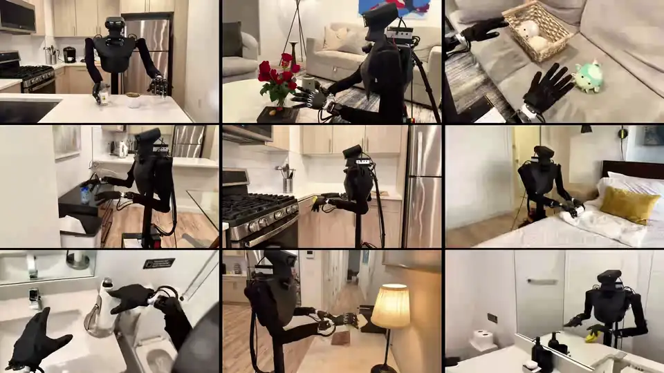
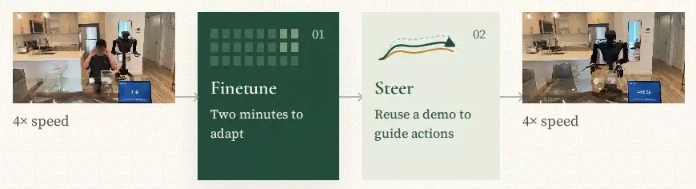
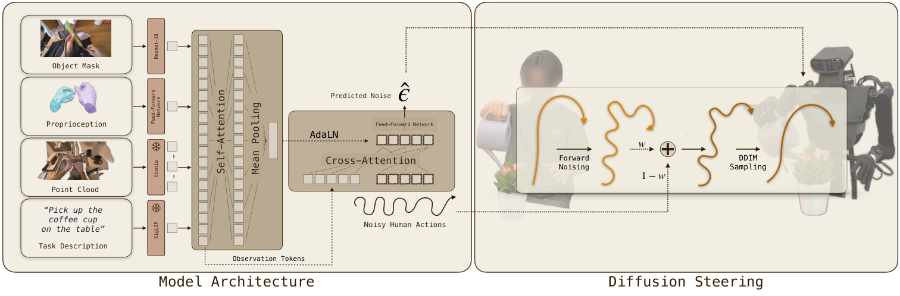
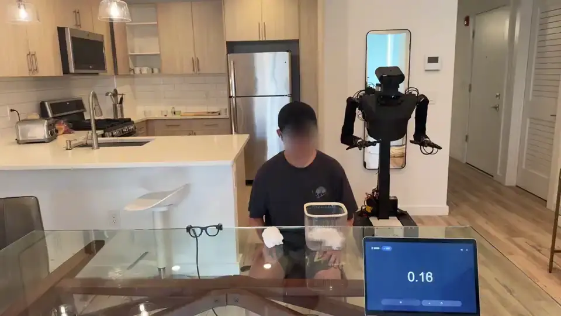
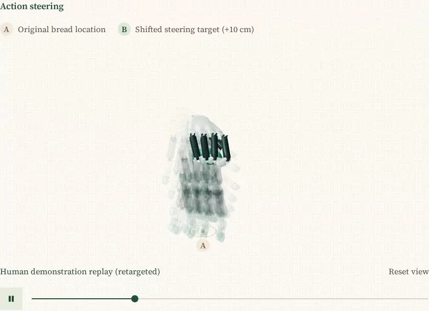
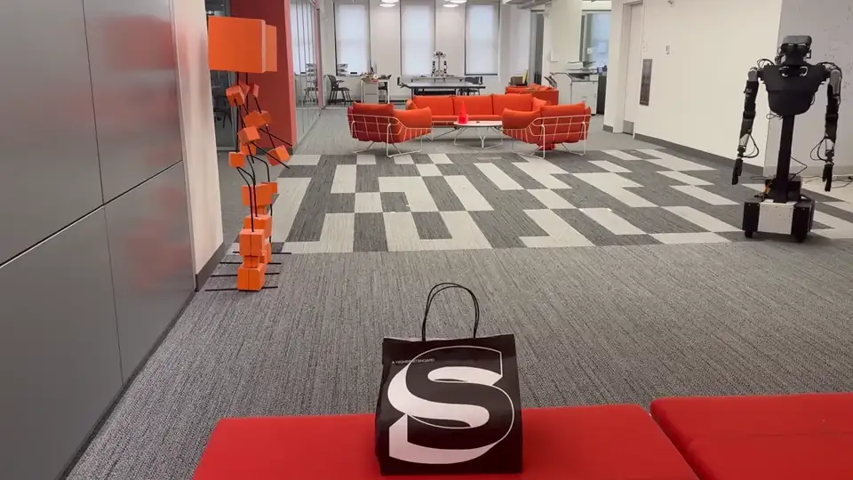

<h1 align="center">Steertuning Policies from a Few Human Videos</h1>

<p align="center">
  <a href="https://billy-yibo-yan.github.io/">Billy Yan</a>,
  <a href="https://www.linkedin.com/in/isaactu7/">Isaac Tu</a>*,
  <a href="https://www.linkedin.com/in/kelly-lee-90a039260/">Kelly Lee</a>*,
  <a href="https://blakechang.com/">Blake Chang</a>,
  <a href="https://kmang0.github.io/KMAWeb/">Kenny Ma</a>,
  <a href="https://kanadpatel.vercel.app/">Kanad Patel</a>,
  <a href="https://www.linkedin.com/in/dhawal-kabra-850775229/">Dhawal Kabra</a>,
  <a href="https://neerpatel.vercel.app/">Neer Patel</a>,
  <a href="https://kevinywu.github.io/">Kevin Wu</a>,
  <a href="https://www.lerrelpinto.com/">Lerrel Pinto</a>,
  <a href="https://irmakguzey.github.io/">Irmak Guzey</a>
  <br/>
  New York University &nbsp;·&nbsp; * equal contribution
</p>

<p align="center">
  <a href="https://steertuning.github.io"></a>
  <a href="https://arxiv.org/pdf/2610.18711"></a>
  <a href="https://arxiv.org/abs/2610.18711"></a>
  <a href="https://github.com/YOR-robot/YOR"></a>
  <a href="https://github.com/KevinyWu/aria2mano"></a>
</p>

Steertuning teaches a robot a new task in a new environment from 5 human demonstrations. We pretrain a 400M-parameter diffusion policy on 100 hours of egocentric human video, fine-tune it with LoRA for 2000 steps, and at deployment steer its actions toward the human demonstration whose scene is closest to the robot's. **5 human demos · under 5 minutes · 71% success across 12 tasks in new environments.**

<p align="center">
  
  <br/>
  <em>Steertuning on YOR with Wuji hands, in kitchens, living rooms, bedrooms and bathrooms.</em>
</p>

## Overview

<p align="center">
  
</p>

1. **Pretrain** on egocentric human video recorded with Aria Gen 2 glasses. Each recording becomes a point cloud with the human removed, an object mask, a task instruction and the future motion of the hands and head.
2. **Fine-tune** LoRA adapters on 5 demonstrations of the new task, for 2000 steps.
3. **Steer.** At every denoising step, the action chunk is pulled toward the matching part of the demonstration with the closest object layout, with weight w = 0.3. The robot follows the predicted hands with mink IK and Wuji retargeting.

<p align="center">
  
</p>

## Installation

Tested on Ubuntu 24.04, CUDA 12.8, PyTorch 2.8.0, Python 3.11. Utonia needs a CUDA GPU. Install with `-e` from a clone, because `assets/` is not package data.

```bash
# 1) Environment
git clone https://github.com/billy-yibo-yan/steertuning_release && cd steertuning_release
conda env create -f environment.yaml && conda activate steertuning
pip install --no-cache-dir --no-build-isolation flash_attn==2.8.3 "git+https://github.com/Pointcept/Utonia@6113b82"
pip install --no-deps "git+https://github.com/facebookresearch/sam3@5a3143c" "git+https://github.com/junhong-3dv/s2m2@b2b20a5"
git clone https://github.com/KevinyWu/aria2mano third_party/aria2mano && git -C third_party/aria2mano checkout 5ac1c1b
pip install --no-deps -e third_party/aria2mano

# 2) Check
python -c "import utonia, sam3, s2m2, wuji_retargeting, aria2mano"
```

- **SAM3**: the weights are gated. Request access at [facebook/sam3](https://huggingface.co/facebook/sam3), then run `hf auth login`.
- **S2M2**: put the [S2M2 weights](https://github.com/junhong-3dv/s2m2) in `third_party/aria2mano/assets/s2m2/`. We use size M.
- **Steertuning weights and data**: linked from the [project page](https://steertuning.github.io). Put them under one folder and `export STEERTUNING_HOME=/path/to/data`. Without it the scripts read `./data`.
- **Gemini**: processing and language commands read `GEMINI_API_KEY` from the environment.

The environment takes about 12 GB of disk, and the weights about 0.7 GB. `flash_attn` compiles from source, with `nvcc`, unless your torch and Python match a prebuilt wheel. A computer that only records needs `pip install -e ".[recording]"`.

<details>
<summary><b>Quick start on CPU, with no weights</b></summary>
<br/>

Python 3.11 and CPU PyTorch are enough:

```bash
python -m venv .venv && source .venv/bin/activate
pip install torch==2.8.0 torchvision==0.23.0 --index-url https://download.pytorch.org/whl/cpu
pip install -e .
python examples/quickstart.py
```

This builds a tiny policy from `configs/policy/tiny.yaml` with stub encoders and random data, fine-tunes LoRA adapters for 100 steps and samples with steering. It prints:

```
Tiny policy with stub encoders: 11.31M parameters, on CPU
Fine-tuned 100 steps: noise loss 1.030 -> 1.003
Steering toward one demonstration, 8 DDIM steps, same seed:
     w   distance to the demonstration (cm)
   0.0                               308.13
   0.3                                19.71
   1.0                                 0.00  (w = 1 replays the demonstration)
```

The numbers show the code path, not robot performance: the tiny policy has seen only noise. At w = 0 the sample is plain DDIM, and at w = 1 it is the demonstration itself.

</details>

<details>
<summary><b>GPU memory and hardware for each step</b></summary>
<br/>

| Step | GPU memory | Aria glasses | SAM3 access | `GEMINI_API_KEY` | Weights | Robot |
|---|---|---|---|---|---|---|
| `examples/quickstart.py` | no GPU | | | | | |
| `scripts/record_demo.py` | no GPU | yes | | | | |
| `scripts/process.py` | about 15 GB on one GPU: 7 GB for SAM3 and S2M2, 8 GB for Qwen, with a device setting for each | | yes | yes | | |
| `scripts/pretrain.py` | about 18 GB per GPU at `batch_size: 100`, extrapolated | | | | | |
| `scripts/finetune.py` | about 5 GB | | | | yes | |
| `scripts/deploy.py` on a recording | about 8 GB with an object prompt | | with an object prompt | | yes | |
| `scripts/calibrate_camera.py` | no GPU | yes | | | | yes |
| `scripts/deploy.py` on the robot | about 8 GB, plus about 2 GB for S2M2 | yes | yes | | yes | yes |
| `scripts/navigate.py` | about 5 GB, for SAM3 | | yes | | | yes |
| `scripts/run_command.py` | about 15 GB on one GPU, estimated from the parts: SAM3 stays loaded for navigation while each step loads its policy | yes | yes | yes | yes | yes |

We measured memory on a shared RTX GPU with the default settings, except the lines that say extrapolated or estimated. The pretraining line comes from small batches.

</details>

## Usage

### Teach the robot a new task

<p align="center">
  
  <br/>
  <em>Five human demonstrations of paper disposal, then the robot's rollout.</em>
</p>

Record 5 demonstrations with Aria Gen 2 glasses, process them, fine-tune, and deploy. Keep the glasses' tracking alive, start with both hands in view, open and clear of the objects, repeat the task the same way each time, and keep recording about 5 s after the task ends.

```bash
# 1) Record 5 demonstrations, running this once for each. Enter starts and stops
python scripts/record_demo.py task=pickup_bread stream.host=<publisher address> description="picking up the bread"

# 2) Process them: masks, depth, clouds, instructions and paraphrases
python scripts/process.py task=pickup_bread

# 3) Fine-tune LoRA adapters for 2000 steps. Writes lora/adapter.safetensors
python scripts/finetune.py task=pickup_bread

# 4) Deploy on YOR, see below
python scripts/deploy.py task=pickup_bread instruction="picking up the bread" object_prompt=bread \
    robot.host=<robot computer> camera.host=<Aria computer>
```

A description with a comma needs Hydra's quotes too: `'description="picking up the cup, then placing it"'`.

### Without glasses or a robot

With a downloaded task folder, fine-tuning and a replay of the control loop need only the weights and a GPU. `instruction` is the `task_description` in the task's `text_prompt_augmentations.json`. Without SAM3 access, pass `object_prompt=null`.

```bash
# Fine-tune, then run the control loop on a recording. It asks at the same prompts as on the robot
python scripts/finetune.py task=<task>
python scripts/deploy.py task=<task> instruction="<task_description>" object_prompt=null \
    replay.session=$STEERTUNING_HOME/<task>/<task>_1/preprocessed
```

### Steer your own policy

<p align="center">
  
  <br/>
  <em>Steering toward a target moved 10 cm: the retargeted demonstration, the steering, then the steered prediction.</em>
</p>

`src/steertuning/steering/sampler.py::steered_ddim` takes any denoise callable, so it can steer another diffusion policy. `examples/steer_your_policy.py` does that with a toy denoiser and no policy class. To load our policy in Python:

```python
from steertuning.policy.policy import SteertuningPolicy

policy = SteertuningPolicy.from_pretrained("/path/to/pretrained", "cuda")
```

A weights folder holds `policy.safetensors`, `config.yaml` and `normalizer.json`.

## Deploy on YOR

<p align="center">
  
  <br/>
  <em>"Pick up the bag and bring it to the table." Gemini ER splits the command into navigate and manipulate steps.</em>
</p>

We deploy on the [YOR](https://www.yourownrobot.ai/) mobile manipulator ([code](https://github.com/YOR-robot/YOR)) with two Wuji hands and Aria Gen 2 glasses on a head mount. YOR is a separate project: install it (`nero` branch, commit 468a660), set up the arm payload and start it as its README says, and check that you can move the robot.

The paper's trials ran on YOR. The deployment and navigation code in this repository has been run on recorded sessions and against simulated servers, not yet on a robot.

Calibrate the camera once per mount (see below), then start these in order:

| Order | Computer | Run |
|---|---|---|
| 1 | Robot | The YOR driver, port 5557. Wait for the arms to finish homing |
| 2 | Robot | `python scripts/wuji_server.py --left-serial <serial> --right-serial <serial>` |
| 3 | Aria | `python -m aria2mano.stream_pub` |
| 4 | Workstation | `python scripts/deploy.py task=<task> instruction="<instruction>" object_prompt=<object> robot.host=<ip> camera.host=<ip>` |

<details>
<summary><b>Setup details: packages, network and camera calibration</b></summary>
<br/>

- **Packages.** Every computer runs `commlink==0.4.2`, YOR's environment included: install it last, over YOR's pin. The robot computer also needs `pip install wujihandpy==1.8.0 numpy` for step 2. Set up the Aria computer for step 3 as in aria2mano's [Real-time Streaming (Gen 2)](https://github.com/KevinyWu/aria2mano#real-time-streaming-gen-2) section; it needs the Aria Client SDK.
- **Network.** Keep all computers on one private network: commlink's RPC servers bind every interface and unpickle what they receive.
- **Camera calibration.** Print ArUco id 1 from DICT_4X4_250 with a 65 mm black square and a white border. Take the left hand off and fix the marker flat on the left end-effector stand, with its corners on the `left_*` sites in `assets/robot/yor_wuji.xml`. With steps 1 and 3 running, run `python scripts/calibrate_camera.py --robot-host <robot computer> --camera-host <Aria computer>`.

</details>

The terminal asks before each move. Type `home` to bring the robot home, Enter starts the rollout, and Enter stops it. Keep a hand on the emergency stop and keep the workspace clear.

For long commands, `scripts/navigate.py` builds a voxel map with SAM3 latents and drives to an object by name, and `scripts/run_command.py` runs a command such as "Put the white cup into the trash".

## Pretraining

Our weights took 1M steps in about 4 days on 2 GPUs. `batch_size` in `configs/pretrain.yaml` is per GPU. Rerunning a command resumes from the newest checkpoint, and the result is in `<output_dir>/pretrained`.

```bash
# From the released human dataset
accelerate launch --num_processes 2 scripts/pretrain.py dataset_root=/path/to/d_wild \
    normalizer=$STEERTUNING_HOME/pretrained/normalizer.json

# From your own recordings
# Record VRS with profile8, run MPS, then aria2mano's process_aria.sh --no-optimize-mano, so each recording has processed/aria_data.pkl
python scripts/process.py path=/path/to/d_wild
accelerate launch --num_processes 2 scripts/pretrain.py dataset_root=/path/to/d_wild \
    normalizer=$STEERTUNING_HOME/pretrained/normalizer.json
```

Pass the released normalizer: fitting a new one on the full dataset needs over 100 GB of RAM. We trained the released weights with our internal code and exported them to the model in this repository. The export fits the proprioception encoder to the trained policy. wandb is off by default: add `wandb.enabled=true`.

## Citation

If you find our work useful, please consider citing our paper:

```bibtex
@article{yan2026steertuning,
  title   = {Steertuning Policies from a Few Human Videos},
  author  = {Yan, Billy and Tu, Isaac and Lee, Kelly and Chang, Blake and Ma, Kenny and Patel, Kanad and
             Kabra, Dhawal and Patel, Neer and Wu, Kevin and Pinto, Lerrel and Guzey, Irmak},
  journal = {arXiv preprint arXiv:2610.18711},
  year    = {2026}
}
```

## Acknowledgments

This work builds on [Utonia](https://github.com/Pointcept/Utonia), [SigLIP](https://huggingface.co/google/siglip-base-patch16-224), [SAM3](https://github.com/facebookresearch/sam3), [S2M2](https://github.com/junhong-3dv/s2m2), [aria2mano](https://github.com/KevinyWu/aria2mano), [Qwen3-VL](https://github.com/QwenLM/Qwen3-VL), Gemini, [YOR](https://github.com/YOR-robot/YOR), [mink](https://github.com/kevinzakka/mink), [MuJoCo](https://github.com/google-deepmind/mujoco), [wuji-retargeting](https://github.com/wuji-technology/wuji-retargeting), [dex-retargeting](https://github.com/dexsuite/dex-retargeting) and [AnyTeleop](https://yzqin.github.io/anyteleop/). Navigation follows [OK-Robot](https://github.com/ok-robot/ok-robot). Steering is inspired by [RePaint](https://arxiv.org/abs/2201.09865), and [DemoDiffusion](https://arxiv.org/abs/2506.20668) is the closest work in robotics.

## License

The code is under the MIT License ([`LICENSE`](LICENSE)). The Utonia weights and S2M2 are CC-BY-NC 4.0, and a policy checkpoint needs the first and trains on depth from the second. Treat checkpoints and adapters as non-commercial, under CC-BY-NC 4.0.
